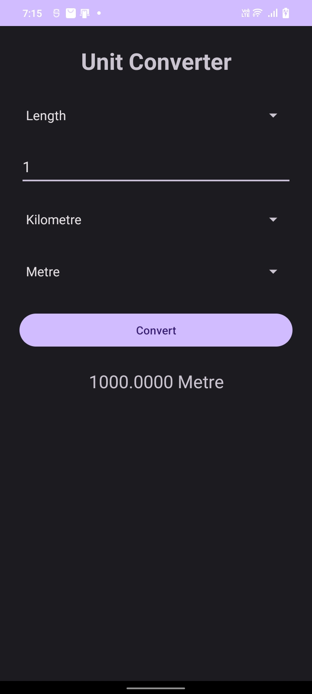
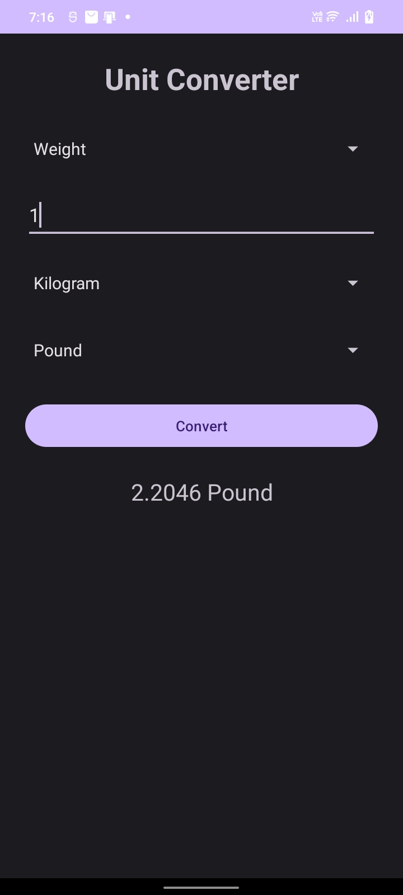

# Unit Converter (Android App)

**Oasis Infobyte Internship (OIBSIP) - Android Application Development**
**Task 1: Unit Converter Application**
**Intern:** Soundariya Leela M

---

## About the Project

A simple Android app that converts values between common units of measurement. The user picks a category, enters a number, chooses the source and target units, and taps **Convert** to see the result instantly.

## Features

- **3 measurement categories:** Length, Weight and Temperature
- **Category selector:** switching category automatically resets the unit dropdowns and clears the result
- **Source and target unit dropdowns (Spinners)**
- **Convert button** that shows the result with the unit label
- **Input validation using Toast messages:**
  - Empty input: "Please enter a value"
  - Non-numeric input: "Please enter a valid number"
  - Temperature below absolute zero: "Temperature cannot be below absolute zero"

## Supported Units

| Category | Units |
|---|---|
| Length | Millimetre, Centimetre, Metre, Kilometre, Inch, Foot |
| Weight | Gram, Kilogram, Pound, Ounce |
| Temperature | Celsius, Fahrenheit, Kelvin |

## How It Works

- **Length and Weight:** every unit has a factor that converts it to a base unit (metre for length, kilogram for weight). The value is first converted to the base unit, then to the target unit. This avoids writing a separate formula for every pair of units.
- **Temperature:** the value is first converted to Celsius, then to the target unit using the standard formulas:
  - Fahrenheit to Celsius: `(F - 32) x 5/9`
  - Kelvin to Celsius: `K - 273.15`
  - Celsius to Fahrenheit: `C x 9/5 + 32`
  - Celsius to Kelvin: `C + 273.15`

## Tech Stack

- Android Studio
- Java
- XML (layouts)

## Screenshots

| Length | Weight | Temperature |
|---|---|---|
|  |  |  |

## How to Run

1. Clone this repository or download it as a ZIP.
2. Open the `Android-Task1-UnitConverter` folder in Android Studio.
3. Wait for the Gradle sync to finish.
4. Connect an Android phone with USB debugging enabled, or start an emulator.
5. Click the green **Run** button.

## Project Structure

```
Android-Task1-UnitConverter/
├── app/src/main/java/com/example/unitconverter/MainActivity.java   (app logic)
├── app/src/main/res/layout/activity_main.xml                       (screen layout)
├── screenshots/
└── README.md
```

## Demo

Demo video: *(add your LinkedIn post link here)*

## Author

**Soundariya Leela M**
Android Application Development Intern, Oasis Infobyte
