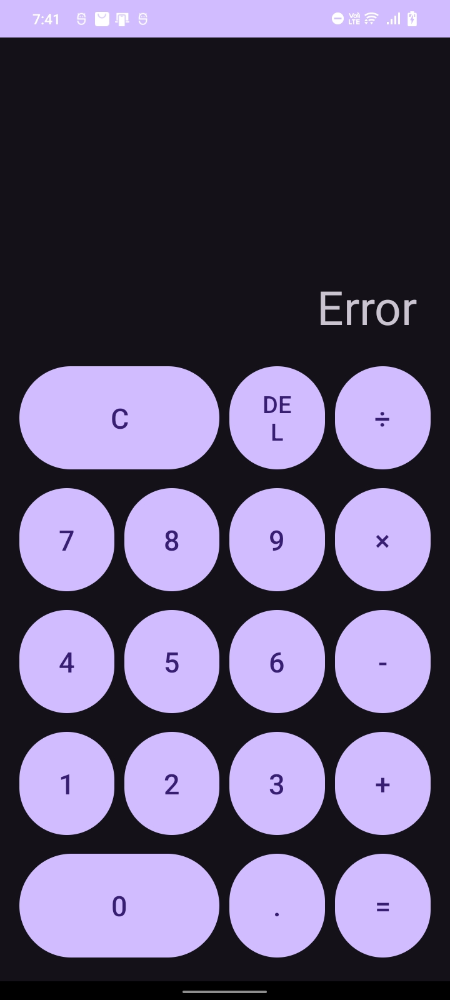

# Calculator (Android App)

**Oasis Infobyte Internship (OIBSIP) - Android Application Development**  
**Task 2: Calculator Application**  
**Intern:** Soundariya Leela M

---

## About the Project

A simple and user-friendly Android calculator application developed using Java and XML in Android Studio. The app performs basic arithmetic calculations with a clean button-based interface. Users can enter numbers, perform calculations, and view results instantly.

## Features

- **Basic arithmetic operations:** Addition, Subtraction, Multiplication and Division
- **Decimal calculations:** Supports decimal numbers and floating-point operations
- **Order of operations:** Performs multiplication and division before addition and subtraction
- **Clear button (C):** Clears the current expression and resets the display
- **Delete button (DEL):** Removes the last entered character
- **Error handling:** Displays an "Error" message when attempting to divide by zero
- **Negative number support:** Allows entering a negative first number
- **Input validation:** Prevents multiple decimal points in the same number
- **Result formatting:** Removes unnecessary trailing zeros and reduces floating-point precision issues
- **Responsive button interface:** Uses a GridLayout to organize calculator buttons

## Supported Operations

| Operation | Symbol | Example | Result |
|---|---|---|---|
| Addition | + | 5 + 3 | 8 |
| Subtraction | - | 9 - 4 | 5 |
| Multiplication | × | 5 + 3 × 2 | 11 |
| Division | ÷ | 9 ÷ 4 | 2.25 |
| Decimal arithmetic | . | 0.1 + 0.2 | 0.3 |

## How It Works

- **User Interface:** The XML layout contains a TextView for displaying the expression and result, along with a GridLayout containing calculator buttons.
- **Button Handling:** A single click listener handles all button clicks and calls the appropriate method based on the selected button.
- **Expression Management:** A StringBuilder stores the current mathematical expression and updates the display whenever a button is pressed.
- **Calculation Logic:** The `evaluate()` method separates numbers and operators, evaluates multiplication and division first, and then performs addition and subtraction.
- **Error Handling:** Division by zero and invalid numeric results are handled using exception handling, displaying an "Error" message instead of crashing the app.
- **Result Formatting:** BigDecimal is used to format results neatly by removing unnecessary trailing zeros.

## Tech Stack

- Android Studio
- Java
- XML (Android layouts)
- Android SDK
- Gradle

## Screenshots

| Normal Calculation | Division by Zero |
|---|---|
|  |  | 


## How to Run

1. Clone this repository or download it as a ZIP file.
2. Open the `Android-Task2-Calculator` folder in Android Studio.
3. Wait for the Gradle sync to finish.
4. Connect an Android phone with USB debugging enabled, or start an Android emulator.
5. Click the green **Run** button to build and launch the application.
6. Enter numbers and choose arithmetic operators to perform calculations.

## Project Structure

```text
Android-Task2-Calculator/
├── app/
│   └── src/
│       └── main/
│           ├── java/
│           │   └── com/example/calculator/
│           │       └── MainActivity.java
│           └── res/
│               └── layout/
│                   └── activity_main.xml
├── Screenshots/
│   ├── calculator.jpeg
│   └── error.jpeg
└── README.md
```

## Demo

Demo video: *Add your published demo video link here.*

## Author

**Soundariya Leela M**

Android Application Development Intern, Oasis Infobyte

---

**#OasisInfobyte #OIBSIP #AndroidDevelopment #Java #AndroidStudio #CalculatorApp #MobileAppDevelopment**
