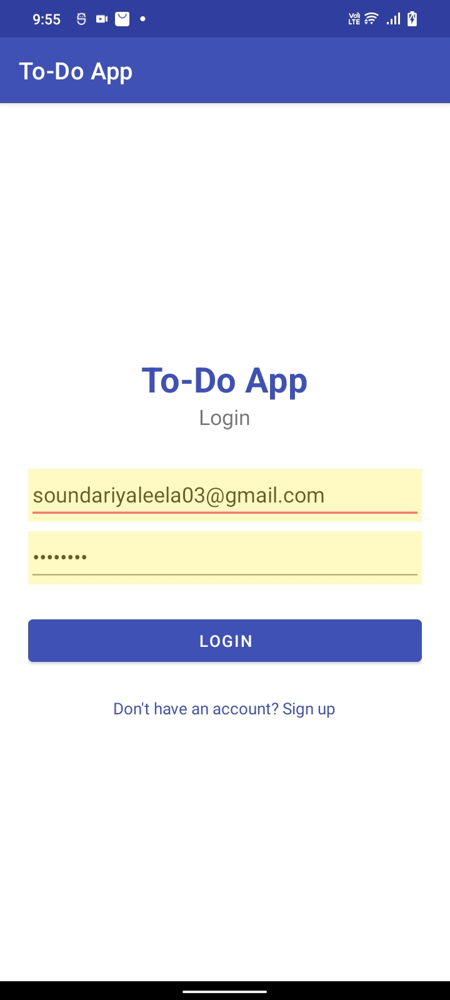
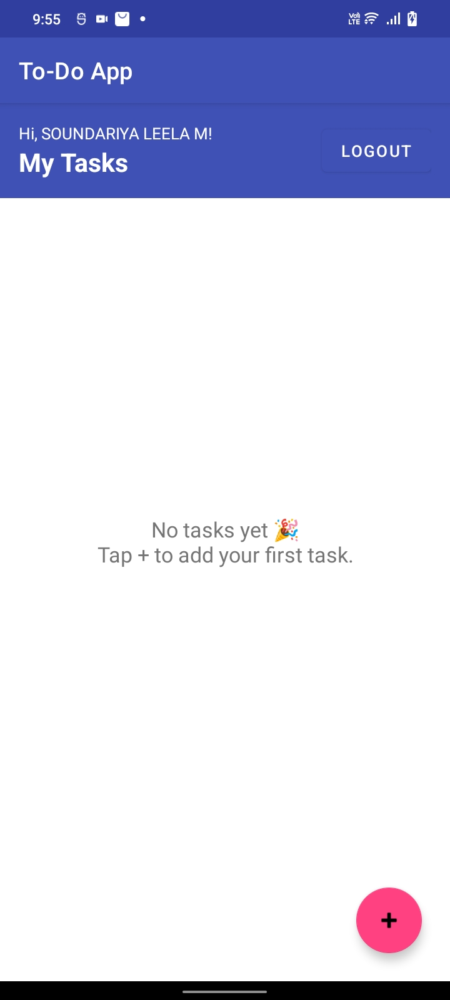
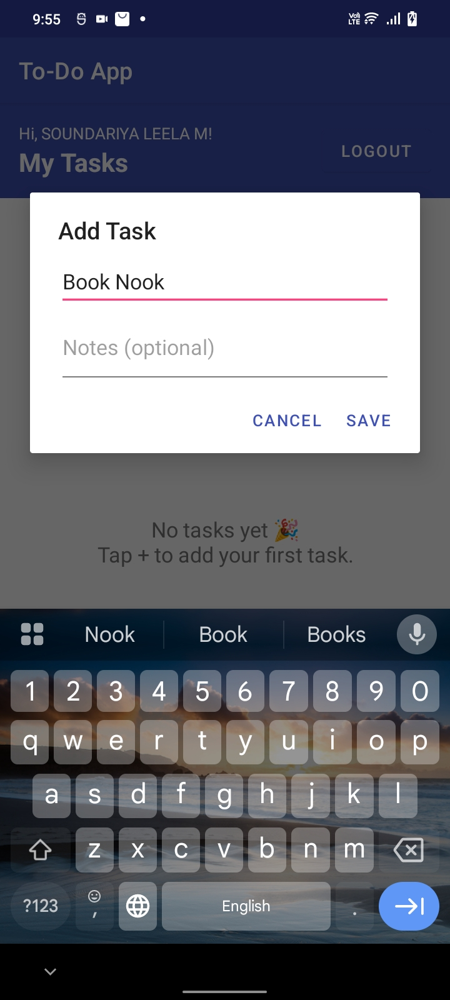
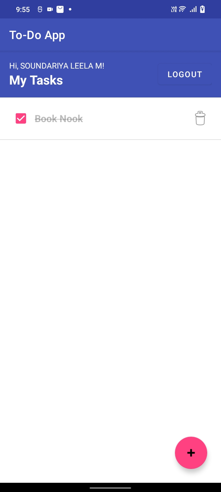

# To-Do App with Login (Android App)

**Oasis Infobyte Internship (OIBSIP) - Android Application Development**  
**Task 2: To-Do App with Login**  
**Intern:** Soundariya Leela M

---

## About the Project

A secure and user-friendly Android task manager developed using Java, XML and SQLite in Android Studio. Users create an account and log in before accessing their own personal to-do list. All data is stored locally on the device, and every task belongs to the user who created it.

## Features

- **Sign-up screen:** Register with name, email and password, with input validation
- **Login screen:** Log in with email and password; wrong credentials show an error message
- **Secure passwords:** Passwords are stored as salted SHA-256 hashes, never as plain text
- **Session handling:** Stays logged in after the app is closed and reopened
- **Logout button:** Clears the session and returns to the login screen
- **Personal task list:** Each user sees only their own tasks
- **Add Task:** Dialog to enter a task name and optional notes
- **Mark as complete:** Checkbox shows completed tasks with a strikethrough and moves them below pending tasks
- **Delete task:** Permanently removes a task after a confirmation prompt
- **SQLite database:** Users and tasks are stored locally, with tasks linked to each user account
- **Empty state:** Friendly message shown when the task list is empty

## Supported Actions

| Action | Where | Result |
|---|---|---|
| Register | Sign-up screen | New account saved with a hashed password |
| Login | Login screen | Opens your personal task list |
| Add task | + button | Task saved to your list |
| Complete task | Checkbox | Strikethrough, moved below pending tasks |
| Delete task | Bin icon | Task removed permanently |
| Logout | Logout button | Session cleared, back to login |

## How It Works

- **User Interface:** XML layouts for login, sign-up, task list, task row and the add-task dialog.
- **Authentication:** `DatabaseHelper` stores each user with a random salt and a SHA-256 password hash. At login the entered password is hashed with the same salt and compared with the stored hash.
- **Session Management:** `SessionManager` keeps the logged-in user in SharedPreferences, and Logout clears it.
- **Database:** `users` and `tasks` tables in SQLite. Each task has a `user_id`, so queries return only the logged-in user's tasks.
- **Task List:** A `ListView` with a custom `TaskAdapter` shows each task with a checkbox, title, notes and delete button.
- **Validation:** Checks for a valid email, minimum password length, duplicate emails and empty task names.

## Tech Stack

- Android Studio
- Java
- XML (Android layouts)
- SQLite (`SQLiteOpenHelper`)
- Android SDK
- Gradle

## Screenshots

| Login | Task List |
|---|---|---|
|  |   |

| Add Task | Empty State |
|---|---|
|  |  |

## How to Run

1. Clone this repository or download it as a ZIP file.
2. Open the `Android-Task2-ToDoAppWithLogin` folder in Android Studio.
3. Wait for the Gradle sync to finish.
4. Connect an Android phone with USB debugging enabled, or start an Android emulator.
5. Click the green **Run** button to build and launch the application.
6. Sign up, log in, then add, complete and delete tasks.

## Project Structure

```text
Android-Task2-ToDoAppWithLogin/
├── app/
│   └── src/
│       └── main/
│           ├── java/
│           │   └── com/oibsip/todoapp/
│           │       ├── LoginActivity.java
│           │       ├── SignupActivity.java
│           │       ├── MainActivity.java
│           │       ├── TaskAdapter.java
│           │       ├── DatabaseHelper.java
│           │       ├── SessionManager.java
│           │       └── Task.java
│           └── res/
│               └── layout/
│                   ├── activity_login.xml
│                   ├── activity_signup.xml
│                   ├── activity_main.xml
│                   ├── item_task.xml
│                   └── dialog_add_task.xml
├── screenshots/
└── README.md
```

## Database Schema

- `users(id, name, email UNIQUE, salt, password_hash)`
- `tasks(id, user_id → users.id, title, notes, completed)`

## Demo

Demo video: https://lnkd.in/p/ggWEwmJp 

## Author

**Soundariya Leela M**

Android Application Development Intern, Oasis Infobyte

---

**#OasisInfobyte #OIBSIP #AndroidDevelopment #Java #AndroidStudio #SQLite #ToDoApp #MobileAppDevelopment**
