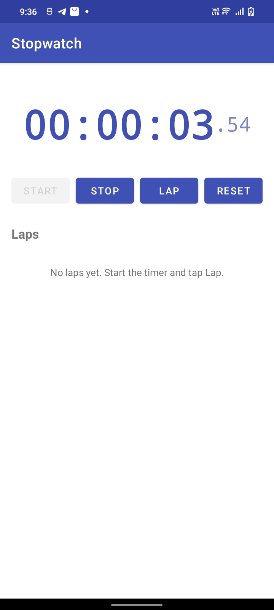
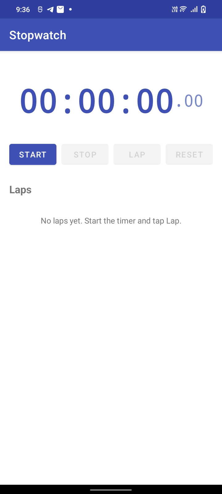
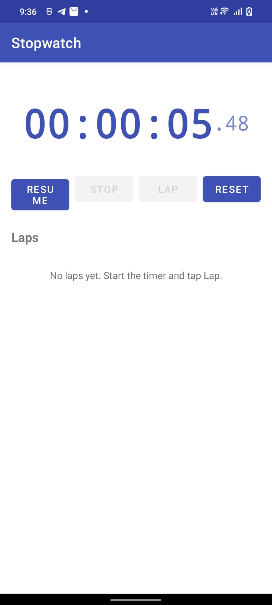

# Stopwatch (Android App)

**Oasis Infobyte Internship (OIBSIP) - Android Application Development**  
**Task 4: Stopwatch**  
**Intern:** Soundariya Leela M

---

## About the Project

A simple and accurate Android stopwatch developed using Java and XML in Android Studio. The app shows elapsed time with hundredth-of-a-second precision and lets you start, stop, resume, record laps and reset. The timer stays correct even when you leave the app and come back.

## Features

- **Large time display:** Shows time in `HH:MM:SS` with hundredths of a second (`.cc`)
- **Start button:** Begins the timer from 0, or resumes from a paused state (the label changes to "Resume")
- **Stop button:** Freezes the timer at the current elapsed time
- **Reset button:** Stops the timer and resets the display to `00:00:00`
- **Button states:** Start is greyed out while running; Stop and Lap are greyed out while stopped; Reset is greyed out when there is nothing to reset
- **Lifecycle handling:** The timer keeps running correctly when you navigate away (`onPause`) and return (`onResume`), and survives screen rotation
- **Lap functionality (bonus):** Lap button records the total time and the split since the previous lap in a scrollable list, newest first
- **Rapid tap safe:** Repeated taps on Start or Stop cannot start duplicate timers

## Supported Actions

| Action | Button | Result |
|---|---|---|
| Start | Start | Timer begins counting from 00:00:00 |
| Pause | Stop | Time freezes at the current value |
| Continue | Resume | Timer continues from the frozen time |
| Record lap | Lap | Adds `Lap n  total  (+split)` to the list |
| Clear | Reset | Display back to 00:00:00 and laps cleared |

## How It Works

- **User Interface:** The XML layout has a large time TextView, four buttons and a ListView for laps.
- **Timer loop:** A `Handler` and `Runnable` update the screen every 10 milliseconds on the UI thread.
- **Accurate timing:** Elapsed time is calculated as `accumulated time + (SystemClock.elapsedRealtime() - start time)` instead of counting ticks, so it never drifts and stays correct if the UI is paused.
- **Activity lifecycle:** `onPause` stops screen updates and `onResume` restarts them; the stopwatch state is also saved in `onSaveInstanceState` so rotation does not reset it.
- **Laps:** Each lap stores the total time and the difference from the previous lap.

## Tech Stack

- Android Studio
- Java
- XML (Android layouts)
- Android SDK (`Handler`, `Runnable`, `SystemClock`)
- Gradle

## Screenshots

| Running | Laps | Stopped |
|---|---|---|
|  |  |  |

## How to Run

1. Clone this repository or download it as a ZIP file.
2. Open the `Android-Task4-Stopwatch` folder in Android Studio.
3. Wait for the Gradle sync to finish.
4. Connect an Android phone with USB debugging enabled, or start an Android emulator.
5. Click the green **Run** button to build and launch the application.
6. Tap Start, try Lap, Stop and Reset, then switch to another app and back to see the timer keep counting.

## Project Structure

```text
Android-Task4-Stopwatch/
├── app/
│   └── src/
│       └── main/
│           ├── java/
│           │   └── com/oibsip/stopwatch/
│           │       └── MainActivity.java
│           └── res/
│               └── layout/
│                   └── activity_main.xml
├── screenshots/
└── README.md
```

## Demo

Demo video: <paste your LinkedIn video link here>

## Author

**Soundariya Leela M**

Android Application Development Intern, Oasis Infobyte

---

**#OasisInfobyte #OIBSIP #AndroidDevelopment #Java #AndroidStudio #Stopwatch #MobileAppDevelopment**
